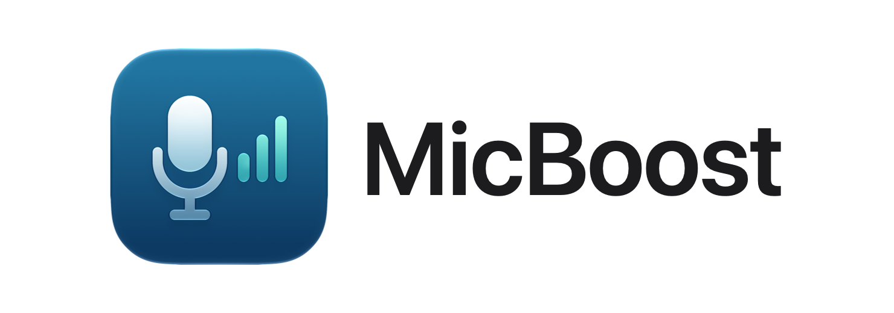
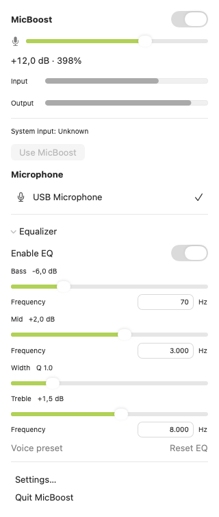
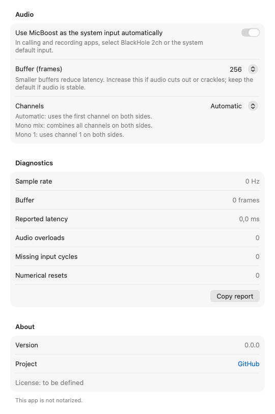

<p align="center"><picture><source media="(prefers-color-scheme: dark)" srcset="docs/design/readme/header-dark.png"></picture></p>

# MicBoost

[](#requirements)
[](#requirements)
[](#requirements)
[](LICENSE)
[](#first-launch)
[](https://github.com/sponsors/vittau)

A native macOS menu bar app that captures the microphone you choose, boosts and shapes it, and
hands the result to [BlackHole 2ch](https://existential.audio/blackhole/) so that every app —
calls, recorders, anything — hears the processed voice.

> [!NOTE]
> This project is developed and maintained with the help of AI agents, under the direction and
> review of its human maintainer.

> [!WARNING]
> **Pre-release:** MicBoost runs from source today. Releases, the Homebrew tap and part of the
> manual validation (accessibility, sleep/wake) are still pending.

## Screenshots

Everything lives in the menu bar: one click opens MicBoost, with the on/off switch, gain, level
meters, the microphone list and the equalizer.

<p align="center">
  <picture>
    <source media="(prefers-color-scheme: dark)" srcset="docs/screenshots/eq-dark.png">
    
  </picture>
  <br>
  <sub>The MicBoost menu: gain, input and output meters, microphone and equalizer.</sub>
</p>

Less frequent choices — automatic system input, buffer size, channels and diagnostics — sit in
the settings window.

<p align="center">
  <picture>
    <source media="(prefers-color-scheme: dark)" srcset="docs/screenshots/settings-dark.png">
    
  </picture>
  <br>
  <sub>Settings: audio options, diagnostics and app information.</sub>
</p>

## How it works

```text
Microphone → 3-band EQ → gain → peak protection → BlackHole 2ch → apps
```

The engine creates a **private aggregate device** with two sub-devices: the chosen source with
drift compensation and BlackHole 2ch as the clock master. A single C IOProc receives the source
input and writes the BlackHole output in the same cycle, so nothing is queued between callbacks.
The added latency is bounded by the buffer and the device safety offsets, and the drift between
the two clocks is handled by Core Audio's drift resampler on the input, before the DSP chain:
the limiter is the last stage, so BlackHole receives exactly what the engine wrote and the
−1 dBFS ceiling holds at its output.
The aggregate is private: other apps never see it, and it disappears with the process.

Gain, mute and the EQ change instantly, without restarting the audio. Peak protection holds the
processed signal at −1 dBFS.

## Features

- **Gain up to +24 dB (1585%)**, which is what a typical USB microphone at speaking distance
  needs to reach call level, plus mute. Gain is shown as a percentage and in decibels, for
  example `200% (+6.0dB)`.
- **Peak protection** with a **Limiter active** badge while it works, so loud moments do not
  distort the call.
- **3-band EQ** — bass, parametric mids and treble — with an on/off switch, a **Voice preset**
  that removes rumble and adds gentle presence without losing body, and **Reset EQ** for a flat
  response.
- **Any Core Audio microphone** — USB, built-in, audio interfaces, Bluetooth, iPhone — captured
  directly, whether or not it is the system input.
- **Automatic system input**: while processing is on, MicBoost becomes the system input, and
  quitting gives the previous one back. It never fights you: if you pick another input yourself,
  the menu offers **Use MicBoost** instead of switching back. You can turn the automation off in
  Settings.
- **One-click on/off switch** that fully releases the microphone, also available with ⌥-click on
  the menu bar icon.
- **Native macOS menu** with the system's own switches, sliders, level meters and menu items,
  following your accent color and light or dark appearance.
- **Low latency without an audio queue**: about 15 ms with a 48 kHz USB microphone at the
  default buffer (see [Latency](#latency)).
- **Automatic recovery**: unplugging and plugging the microphone back in, sleep and wake, a
  missing BlackHole driver, a sample-rate change or a Core Audio restart bring the audio back
  on the same microphone, with a short message when you need to act.
- **Best shared sample rate**: 48 kHz when the microphone and BlackHole both support it,
  otherwise the best rate they share; the previous rates come back when you quit.
- **Settings** for buffer size, channel mapping (Mono 1, Mono 2…, Mix, Stereo) and diagnostics.
- **English and Brazilian Portuguese.**

## Requirements

- macOS 14 Sonoma or later, on Apple Silicon or Intel.
- [BlackHole 2ch](https://existential.audio/blackhole/) installed as a separate driver.
- Microphone permission for MicBoost (and for your terminal when using diagnostics).
- To build from source: Xcode 27.2 / Swift 6.4.

## Install

MicBoost is not released yet. **The only way to run it today is to build from source** — see
[Building from source](#building-from-source).

**Planned, not available:** a Homebrew tap (`vittau/micboost`, cask `micboost`) that depends on
the `blackhole-2ch` cask, and a `.zip` release on GitHub Releases. Neither exists yet; do not
expect those commands to work.

BlackHole 2ch itself is installable now:

```sh
brew install --cask blackhole-2ch
```

## First launch

A build you compile locally is ad-hoc signed and not quarantined, so it opens normally. The
"Open Anyway" flow below applies once a downloadable build exists:

1. Open MicBoost. macOS blocks it because the app is not notarized.
2. Go to System Settings → Privacy & Security, click **Open Anyway** and confirm with your
   password or Touch ID.
3. Later launches show no warning. A new binary may repeat the flow.

On macOS 15 and later, Control-click → Open no longer bypasses the block; use step 2. MicBoost
never disables Gatekeeper or SIP and never removes the quarantine flag, and neither should you.

## Usage

1. Open MicBoost and allow microphone access.
2. Click its menu bar icon and choose your microphone. MicBoost sets the processed input as
   the system input automatically by default; disable this in Audio settings if desired.
3. Adjust gain, mute and EQ in the menu. Close it whenever you like; audio keeps running.
4. In your calling or recording app, choose **BlackHole 2ch** or **System Default**.
5. Turn processing off to release the microphone, or choose **Quit MicBoost** (⌘Q). The previous
   system input is restored if automatic switching is enabled and you have not changed it yourself.

### Diagnostics

`swift run micboost-diag devices` lists inputs. The CLI also supports capture, latency and
stability measurements; see [the diagnostic reference](docs/testing.md).

## Latency

The number that matters is the **added latency**: from a sample being available at the source to
the same sample being available to a reader of BlackHole 2ch. It is measured by
`micboost-diag latency`, which runs the engine in-process, records the source and the BlackHole
input with host timestamps, correlates the room signal between both recordings and reports the
median of repeated trials. The consumer app's own latency is measured separately and is not part
of this figure.

Recorded on a MacBook Neo (Apple A18 Pro), macOS 27.2, with room-signal correlation and 3 trials
per buffer:

| Buffer | USB mic at 48 kHz | USB webcam mic at 16 kHz |
| --- | --- | --- |
| 64 frames | 7.3 ms | 14.9 ms |
| 128 frames | 10.0 ms | 22.9 ms |
| 256 frames (default) | 15.3 ms | 38.9 ms |

A buffer is a fixed number of frames, so it lasts three times longer at 16 kHz than at 48 kHz;
that is why the low-rate source is slower.

- **v1 acceptance:** median ≤ 100 ms for every supported source, except sources whose own
  reported input latency already exceeds that value — Continuity is one, at 125 ms.
- **Engineering goal:** median < 20 ms at the default buffer for USB and built-in sources at
  48 kHz — met by the USB microphone above. This is the requirement of the v2 monitor mode, where
  the total delay must stay under 20 ms to avoid hearing an echo.
- **Stability:** a 20-minute run at the default buffer stayed within 0.7 ms of its starting
  latency, with no overloads, no missing input, stable memory (about 13 MB) and about 0.5% of one
  CPU core.
- **Recovery:** unplugging the USB microphone during a run moves the engine to "recovering", with
  silence in BlackHole; plugging it back in resumes the bridge on its own. Changing the working
  rate of either end returns to `running` in 0.4–1.3 s.
- **Still pending:** built-in microphone and Bluetooth measurements.

Full results and conditions: [docs/testing.md](docs/testing.md#resultados-registrados).

## Known limitations

- **Bluetooth headsets** use the voice profile (HFP) while their microphone is active: the
  sample rate drops to 16 or 24 kHz, the headset's own output degrades, and latency grows.
  Bluetooth is supported with these limitations.
- **Continuity (iPhone microphone)** reports 6000 frames of input latency — 125 ms at 48 kHz —
  before MicBoost adds anything. The 100 ms acceptance does not apply to a source that already
  exceeds it.
- **The built-in microphone is muted by hardware when the lid is closed.** macOS keeps the
  permission granted and the callbacks keep firing, but they deliver zeros; MicBoost cannot
  capture audio in that state.
- **Digital gain amplifies noise too**, and it cannot recover audio that was already clipped at
  the source. If your microphone has a hardware gain knob, or you can speak closer to it, use that
  first.
- **MicBoost changes the sample rate of the selected microphone** to the working rate it shares
  with BlackHole (48 kHz when both support it). Other apps that read that microphone directly
  adapt to the change, and the previous rate is restored when you quit or switch microphones.
- **Changing a rate while MicBoost runs** pauses the bridge for about half a second to a second
  while the engine rebuilds at the working rate. The BlackHole driver may ignore the external
  write while MicBoost holds it.

## Troubleshooting

**The app is blocked by macOS.** That is expected for a non-notarized build — see
[First launch](#first-launch). Do not remove the quarantine flag.

**No microphone audio.** Check System Settings → Privacy & Security → Microphone. When running
the CLI, the permission belongs to the terminal application, not to MicBoost. If you granted the
permission while MicBoost was in the background, click back into the app or its menu; the
permission is re-checked when the app becomes active.

**BlackHole 2ch is not found.** Install it with `brew install --cask blackhole-2ch` and run
`swift run micboost-diag devices`; the second line of the output reports the detected BlackHole.
MicBoost does not install or bundle the driver. Once the driver appears, the message clears on its
own and the bridge starts again.

**The audio stops for a moment and comes back.** That is the automatic recovery: the microphone
was disconnected, the Mac slept, another app changed the rate, or the Core Audio service
restarted. MicBoost rebuilds the bridge on the same microphone and keeps the system input on
BlackHole, so apps listening to it do not switch microphones.

**The other app hears silence.** Make sure it is listening to **BlackHole 2ch** or **System
Default**, and that System Settings → Sound → Input is set to BlackHole 2ch. Apps with their own
device picker ignore the system default.

**Captures come back as zeros.** Check the microphone permission first, then whether the source is
a Continuity or Bluetooth device that has not connected yet.

**A feedback loop.** BlackHole cannot be chosen as the source; the list excludes it. If you hear
feedback, the calling app is monitoring its own output.

## Uninstall

MicBoost is not installed anywhere yet. To clean up a local build, quit MicBoost from its menu, then delete the checkout and its
`build/` directory. Settings are removed with:

```sh
defaults delete io.github.vittau.MicBoost
```

BlackHole is never removed by MicBoost, because other apps may depend on it. Remove it yourself
with `brew uninstall --cask blackhole-2ch` if you no longer need it.

## Building from source

```sh
git clone https://github.com/vittau/MicBoost.git
cd MicBoost
swift build
swift test
scripts/build-app.sh debug
open build/MicBoost.app
```

`swift test` runs without audio hardware, BlackHole or microphone permission. `build-app.sh`
assembles and ad-hoc signs `build/MicBoost.app`. The app lives in the menu bar. The project is a single SwiftPM package — there is
no `.xcodeproj`.

## Support

MicBoost is a spare-time project. If it saves you from buying a microphone booster, you can chip
in:

[](https://github.com/sponsors/vittau)
[](https://www.buymeacoffee.com/vittau)

## License

MicBoost is free software, released under the [GNU General Public License v3.0](LICENSE). You may
use, study, modify and share it; versions you distribute must stay under the same license, with
their source code available.

## Credits

- **[BlackHole 2ch](https://github.com/ExistentialAudio/BlackHole)** by Existential Audio — the
  virtual audio driver MicBoost writes to. It is installed separately and used unmodified;
  MicBoost does not bundle it or incorporate its code.
- **[VirtuMic](https://github.com/ShotgunZZ/VirtuMic)** and **LitLink** — products evaluated
  before building MicBoost, whose limitations motivated it. MicBoost is an independent
  implementation and reuses no code or assets from either.
- The section structure of this README was inspired by the VirtuMic README. No text was copied
  from it.
- The icon and the header images are original artwork for this project.

MicBoost is not affiliated with, endorsed by or sponsored by Apple Inc. or Existential Audio.
**Apple**, **macOS** and **Mac** are trademarks of Apple Inc.; **BlackHole** is a product of
Existential Audio. All trademarks belong to their respective owners and are used here only to
describe what MicBoost does.
