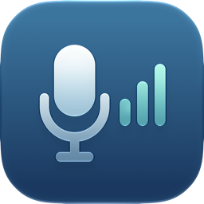
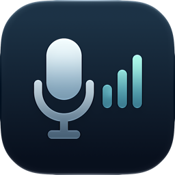
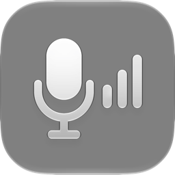
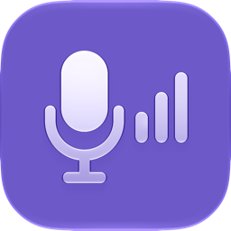

<p align="center"><picture><source media="(prefers-color-scheme: dark)" srcset="docs/design/readme/header-dark.png"></picture></p>

# MicBoost

[](#requirements)
[](#requirements)
[](#requirements)
[](#first-launch)
[](https://github.com/sponsors/vittau)

A native macOS menu bar app that captures the microphone you choose, boosts and shapes it, and
hands the result to [BlackHole 2ch](https://existential.audio/blackhole/) so that every app —
calls, recorders, anything — hears the processed voice.

> [!NOTE]
> This project is developed and maintained with the help of AI agents, under the direction and
> review of its human maintainer.

> [!WARNING]
> **Pre-release: the app is a menu bar icon with a Quit item, and there is no download or
> Homebrew tap yet.**
>
> **Working today (stage 1):** a device-agnostic capture → BlackHole 2ch bridge, driven by the
> `micboost-diag` command-line tool. It captures any Core Audio input by UID through a private
> aggregate device, with no queue between callbacks. Measured on a USB microphone (C920) at
> 16 kHz: median **38.94 ms** of added latency at the default 256-frame buffer, an 18-minute
> stability run with **−0.06 ms** of drift and 0 overloads, and safe silence when the source
> delivers no signal.
>
> **Still planned:** gain and peak protection (stage 2), the 3-band EQ (stage 3), the menu bar
> panel and settings window (stage 4), recovery (stage 5), and the Homebrew tap with a `.zip`
> release (stage 6). Progress lives in [the roadmap](docs/roadmap.md).

## The app icon

| Light | Dark |
| --- | --- |
|  |  |
| **Clear** | **Tinted** |
|  |  |

*The icon is a layered Liquid Glass document (`Resources/AppIcon.icon`) rendered by Icon Composer
in six appearances: light, dark, tinted light/dark and clear light/dark. These 256 px previews come
from `design/icon/previews/` and are refreshed by `scripts/render-readme-header.sh`. Panel
screenshots will be real SwiftUI renders of the app with sample state, added together with the UI
stage.*

## How it works

```text
Microphone → 3-band EQ → gain → peak protection → BlackHole 2ch → apps
```

The engine creates a **private aggregate device** with two sub-devices: the chosen source as the
clock master and BlackHole 2ch with drift compensation. A single C IOProc receives the source
input and writes the BlackHole output in the same cycle, so nothing is queued between callbacks.
The added latency is bounded by the buffer and the device safety offsets, and the drift between
the two clocks is handled by Core Audio's drift resampler instead of a ring buffer that grows.
The aggregate is private: other apps never see it, and it disappears with the process.

The EQ, gain and peak protection in that chain are still being built; today the bridge passes
audio through unchanged.

## Features

Available today:

- **Any Core Audio input**, captured explicitly by UID — the source does not have to be the
  system default input.
- **No audio queue**: private aggregate device and one IOProc, with latency measured and
  documented below.
- **BlackHole 2ch as the destination**, with BlackHole variants and aggregates containing
  BlackHole excluded from the source list, so feedback cannot be selected.
- **Safe silence on zero input**: a source that delivers zeros — the built-in microphone with the
  lid closed, for example — produces silence in BlackHole, not noise.

Planned for v1:

- **Gain above +6 dB (200%)** with mute and peak protection, without a ceiling inherited from
  another product (stage 2).
- **3-band EQ** — low shelf, one parametric mid band and high shelf — with bypass and a reset
  action (stage 3).
- **Menu bar panel** with gain, meters, routing status, source list and the EQ section, plus a
  settings window for buffer, channels and diagnostics (stage 4).
- **Recovery** from a disconnected source, sleep/wake, format changes and a missing BlackHole
  (stage 5).
- **Homebrew tap and `.zip` release** (stage 6).

## Requirements

- macOS 14 Sonoma or later, on Apple Silicon or Intel.
- [BlackHole 2ch](https://existential.audio/blackhole/) installed as a separate driver.
- Microphone permission for MicBoost — or, while there is no UI, for the terminal application
  that runs `micboost-diag`.
- To build from source: Xcode 27.2 / Swift 6.4.

## Install

MicBoost is not released yet. **The only way to run it today is to build from source** — see
[Building from source](#building-from-source).

**Planned, not available:** a Homebrew tap (`vittau/micboost`, cask `micboost`) that depends on
the `blackhole-2ch` cask, and a `.zip` release on GitHub Releases. Neither exists yet; do not
expect those commands to work.

BlackHole 2ch itself is installable now:

```sh
brew install --cask blackhole-2ch
```

## First launch

A build you compile locally is ad-hoc signed and not quarantined, so it opens normally. The
"Open Anyway" flow below applies once a downloadable build exists:

1. Open MicBoost. macOS blocks it because the app is not notarized.
2. Go to System Settings → Privacy & Security, click **Open Anyway** and confirm with your
   password or Touch ID.
3. Later launches show no warning. A new binary may repeat the flow.

On macOS 15 and later, Control-click → Open no longer bypasses the block; use step 2. MicBoost
never disables Gatekeeper or SIP and never removes the quarantine flag, and neither should you.

## Usage

The bridge runs from the diagnostic CLI until the menu bar panel exists:

1. Install BlackHole 2ch and grant microphone permission to your terminal application.
2. List the inputs and note the UID of the microphone you want:

   ```sh
   swift run micboost-diag devices
   ```

3. Make BlackHole 2ch the system input in System Settings → Sound → Input. Apps that use the
   "system default" microphone read it. Until the app has a UI, MicBoost does not change the
   system input for you.
4. Start the bridge:

   ```sh
   swift run micboost-diag run --input <uid> --seconds 300
   ```

5. In the calling or recording app, select **BlackHole 2ch** — or **System Default** — as the
   microphone.
6. Stop with Control-C when you are done, and set your microphone back in System Settings →
   Sound → Input. The private aggregate device disappears with the process.

The CLI also reports microphone authorization (`micboost-diag permission`), records raw input
(`micboost-diag capture --device <uid> --seconds 3 --out take.wav`), measures latency
(`micboost-diag latency --input <uid>`) and runs a stability soak
(`micboost-diag soak --input <uid> --minutes 20`). See [docs/testing.md](docs/testing.md) for
every option.

## Latency

The number that matters is the **added latency**: from a sample being available at the source to
the same sample being available to a reader of BlackHole 2ch. It is measured by
`micboost-diag latency`, which runs the engine in-process, records the source and the BlackHole
input with host timestamps, correlates the room signal between both recordings and reports the
median of repeated trials. The consumer app's own latency is measured separately and is not part
of this figure.

Recorded on a MacBook Neo (Apple A18 Pro), macOS 27.2, USB microphone (Logitech C920), 16 kHz,
room-signal correlation, 3 trials:

| Buffer | Median added latency |
| --- | --- |
| 64 frames | 14.94 ms |
| 128 frames | 22.88 ms |
| 256 frames (default) | 38.94 ms |

- **v1 acceptance:** median ≤ 100 ms for every supported source, except sources whose own
  reported input latency already exceeds that value — Continuity is one, at 125 ms.
- **Engineering goal:** median < 20 ms at the default buffer for USB and built-in sources at
  48 kHz. This is the requirement of the v2 monitor mode, where the total delay must stay under
  20 ms to avoid hearing an echo.
- **Stability:** an 18-minute run at buffer 256 kept the median at 38.88 → 38.81 ms (−0.06 ms
  drift) with 0 overloads, 0 input-missing events, 0 non-finite resets and about 0.4% of one
  CPU core.
- **Still pending:** built-in microphone latency (it was unavailable, lid closed), 48 kHz
  measurements, Bluetooth, the final 20-minute soak and memory stability — memory was recorded
  only as peak resident size, so nothing is claimed about it here.

Full results and conditions: [docs/testing.md](docs/testing.md#resultados-registrados).

## Known limitations

- **Bluetooth headsets** use the voice profile (HFP) while their microphone is active: the
  sample rate drops to 16 or 24 kHz, the headset's own output degrades, and latency grows.
  Bluetooth is supported with these limitations.
- **Continuity (iPhone microphone)** reports 6000 frames of input latency — 125 ms at 48 kHz —
  before MicBoost adds anything. The 100 ms acceptance does not apply to a source that already
  exceeds it.
- **The built-in microphone is muted by hardware when the lid is closed.** macOS keeps the
  permission granted and the callbacks keep firing, but they deliver zeros; MicBoost cannot
  capture audio in that state.
- **Digital gain amplifies noise too**, and it cannot recover audio that was already clipped at
  the source. The panel will show input clipping once the UI exists.

## Troubleshooting

**The app is blocked by macOS.** That is expected for a non-notarized build — see
[First launch](#first-launch). Do not remove the quarantine flag.

**No microphone audio.** Check System Settings → Privacy & Security → Microphone. When running
the CLI, the permission belongs to the terminal application, not to MicBoost.

**BlackHole 2ch is not found.** Install it with `brew install --cask blackhole-2ch` and run
`swift run micboost-diag devices`; the second line of the output reports the detected BlackHole.
MicBoost does not install or bundle the driver.

**The other app hears silence.** Make sure it is listening to **BlackHole 2ch** or **System
Default**, and that System Settings → Sound → Input is set to BlackHole 2ch. Apps with their own
device picker ignore the system default.

**Captures come back as zeros.** Check the microphone permission first, then whether the source is
a Continuity or Bluetooth device that has not connected yet.

**A feedback loop.** BlackHole cannot be chosen as the source; the list excludes it. If you hear
feedback, the calling app is monitoring its own output.

## Uninstall

MicBoost is not installed anywhere yet. To clean up a local build, quit the CLI with Control-C,
restore your microphone in System Settings → Sound → Input, then delete the checkout and its
`build/` directory. Settings, once the app writes them, are removed with:

```sh
defaults delete io.github.vittau.MicBoost
```

BlackHole is never removed by MicBoost, because other apps may depend on it. Remove it yourself
with `brew uninstall --cask blackhole-2ch` if you no longer need it.

## Building from source

```sh
git clone https://github.com/vittau/MicBoost.git
cd MicBoost
swift build
swift test
scripts/build-app.sh debug
open build/MicBoost.app
```

`swift test` runs without audio hardware, BlackHole or microphone permission. `build-app.sh`
assembles and ad-hoc signs `build/MicBoost.app`. The app currently opens a menu bar item with only
**Quit**; the panel arrives with the UI stage. The project is a single SwiftPM package — there is
no `.xcodeproj`.

## Support

MicBoost is a spare-time project. If it saves you from buying a microphone booster, you can chip
in:

[](https://github.com/sponsors/vittau)
[](https://www.buymeacoffee.com/vittau)

## License

**Not decided yet.** The repository carries no license grant while the choice is open; GPL-3.0 is
the current recommendation, because it aligns with BlackHole and simplifies a future combined
installer. See the open decisions in [the roadmap](docs/roadmap.md#decisões-em-aberto).

## Credits

- **[BlackHole 2ch](https://github.com/ExistentialAudio/BlackHole)** by Existential Audio — the
  virtual audio driver MicBoost writes to. It is installed separately and used unmodified;
  MicBoost does not bundle it or incorporate its code.
- **[VirtuMic](https://github.com/ShotgunZZ/VirtuMic)** and **LitLink** — products evaluated
  before building MicBoost, whose limitations motivated it. MicBoost is an independent
  implementation and reuses no code or assets from either.
- The section structure of this README was inspired by the VirtuMic README, and its presentation
  by the [Doom-Deck-Launcher](https://github.com/vittau/Doom-Deck-Launcher) README. No text was
  copied from either.
- The icon and the header images are original artwork for this project.

MicBoost is not affiliated with, endorsed by or sponsored by Apple Inc. or Existential Audio.
**Apple**, **macOS** and **Mac** are trademarks of Apple Inc.; **BlackHole** is a product of
Existential Audio. All trademarks belong to their respective owners and are used here only to
describe what MicBoost does.
